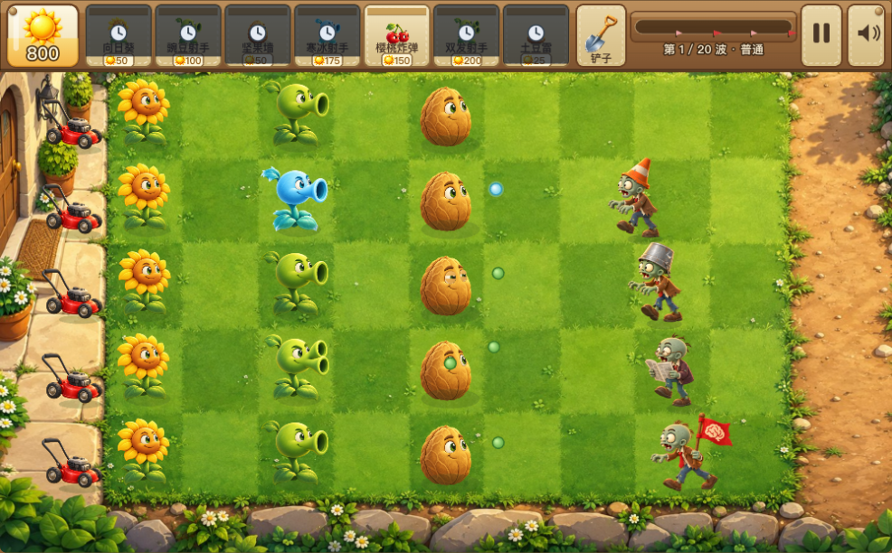

# 阳光庭院塔防

一款可直接在浏览器运行的花园塔防游戏。收集阳光、安排植物阵容，守住五条草坪防线。

采用原生 JavaScript 与 Canvas 2D，包含完整源码、静态设计图、透明序列帧、切帧数据和可交互素材预览。无需构建，没有运行时第三方依赖。



## 跟着制作

[从 MVP 到素材、八帧动画与修复的四步教程](docs/tutorial.md)，包含 frontend-design 来源、安装方法与可复制提示词。另有可单独分享的 [HTML 阅读版](docs/tutorial.html)。

## 开始游戏

下载仓库并解压，用桌面 Chrome、Edge 或 Safari 打开 `index.html`。

也可以启动本地服务：

```sh
python3 -m http.server 8080 --bind 127.0.0.1
```

随后访问 `http://127.0.0.1:8080`。游戏资源全部位于仓库内，支持离线运行。

## 游戏内容

- 7 种植物、7 种敌人、20 波关卡，提供三档难度。
- 阳光收集、种植冷却、铲除、草坪小推车与暂停操作。
- 爆炸、冰冻碎片、啃食反馈、受损形象及特殊敌人状态。
- 植物根部固定的轻微摆动、僵尸行走序列帧和静态选卡。
- WebAudio 实时合成音效；当前版本不播放背景音乐。

土豆雷需要约 14 秒成熟。成熟后在敌人接触时爆炸；未成熟时可能被吃掉。撑杆敌人可以跳过它，落地后再次接触会触发。

## 操作

| 操作 | 方法 |
| --- | --- |
| 选择植物 | 点击卡片或按 `1`–`7` |
| 种植 | 点击草坪空格 |
| 收集阳光 | 点击阳光及周边热区 |
| 移除植物 | 选择铲子后点击植物 |
| 取消选择 | `Esc` 或鼠标右键 |
| 暂停 / 继续 | `P` |
| 静音 / 开启音效 | `M` |

## 源码与素材

| 目录 | 内容 |
| --- | --- |
| `js/` | 配置、实体、战斗、绘制、输入与音效 |
| `css/` | 游戏界面样式 |
| `assets/designs/` | 植物、太阳、铲子与小推车静态设计 |
| `assets/plants/` | 植物图集、透明版本、切帧 JSON、提示词和预览 |
| `assets/zombies/` | 7 种敌人静态形象及行走图集 |
| `assets/states/` | 坚果受损、撕报暴怒和撑杆落地形象 |
| `assets/tools/` | 铲子、小推车图集及预览 |
| `assets/backgrounds/` | 庭院背景 |
| `assets/audio/` | 保留的可选音乐素材，当前游戏不加载 |
| `test/` | 无外部依赖的逻辑回归测试 |
| `tools/` | 重新生成图集运行时数据的工具 |

打开 [素材库](assets/index.html) 可查看全部设计资产；各序列帧目录包含暂停、步进、调速预览。素材列表和文件校验值见 [assets/manifest.json](assets/manifest.json)。

游戏采用混合动画：部分植物使用静态母版分层摆动，僵尸使用行走图集，小推车仅移动时播放动作。保留的序列帧适合学习、检查与继续开发，不代表每套图集都在当前待机画面中循环。

## 开发与测试

需要 Node.js 18 或更新版本，测试无需安装依赖：

```sh
npm test
```

调整植物数值或波次：`js/config.js`；战斗与状态：`js/entities.js`、`js/game.js`；素材映射：`js/design-art.js`、`js/sheet-data.js`、`js/zombie-sheet-data.js`。

可选的图集数据生成工具：

```sh
python3 -m pip install -r tools/requirements.txt
python3 tools/regenerate-sheet-data.py
```

`mine-recording.html` 是土豆雷的原速测试与竖屏录制页，使用预设单敌人场景和真实游戏更新流程。

## 许可

[MIT License](LICENSE)。
