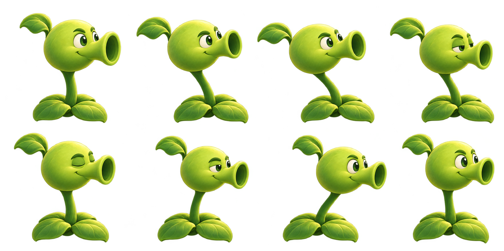

# 跟着我做一款花园塔防游戏

文 / Archie在摸鱼

视频里，我从一个能种植物、能打僵尸的简陋版本开始，逐步换上庭院背景、角色素材和动画，最后再把交互和战斗里的问题一个个修掉。这篇把过程补完整，你可以从零做，也可以拿我的项目接着改。

完整项目放在这里：[阳光庭院塔防 · GitHub](https://github.com/TowardFutureMan/sunshine-garden-defense)。源码、设计图、序列帧和素材预览都在仓库里。想先玩一下，点仓库的 **Code → Download ZIP**，解压后用电脑浏览器打开 `index.html`。打开 `assets/index.html`，可以看素材；部分动画目录还保留了逐帧预览页。


下面的提示词是根据这次迭代整理的可复用版本。文件名、角色和风格都可以换成你自己的，生成结果还是要打开看看、实际点一点。

## 第一步：先把游戏做出来，玩一遍

打开 WorkBuddy，新建一个游戏文件夹，选择 **Step 5 Preview**，先做 MVP，也就是最小可行版本。这个阶段我只关心一件事：种下植物以后，游戏能不能真的玩起来。

第一轮可以这样说：

```text
在当前文件夹里做一款浏览器可以运行的花园塔防游戏，用 HTML、CSS、JavaScript 和 Canvas 实现。

草坪按 5 行 9 列排列。玩家收集阳光、选择植物并种在空格里；僵尸从右侧进入，植物向右攻击，同一行的敌人能够吃植物。先完成阳光、种植、攻击、受伤、胜负、重新开始这些基础流程。

第一版用简单图形即可。把植物数值、网格坐标、游戏逻辑和绘制拆开，方便后面替换美术素材。交付可运行的项目，并告诉我如何打开。完成后实际运行检查，不要只给代码片段。
```

生成后先试一局：阳光能不能收集，植物能不能种进选中的格子，子弹有没有伤害，敌人吃完植物会不会继续走。哪一项没跑通，就先解决哪一项。

这里有个小习惯很管用：每完成一轮，就保存一份能运行的版本。后面换图、加动画时，旧版既能拿来对比，也方便出问题时退回去。

这篇沿用视频里的工具与模型选择；模型是否可选、活动是否免费，以你使用时客户端的实际显示为准。

## 第二步：用 frontend-design 整理画面

玩法跑通以后，我才开始改界面。只说“帮我做得高级一点”，很容易得到一堆渐变、发光和装饰，却没有解决选卡看不清、草坪太挤的问题。

这一步用的是 **frontend-design**。它能给界面改造提供设计方法，重点是视觉方向、排版、颜色和布局。游戏的美术素材和动作，还要在下一步单独处理。[Skill 官方源码](https://github.com/anthropics/skills/tree/main/skills/frontend-design)

安装时，先在 WorkBuddy 的技能页面搜索 `frontend-design`，核对来源后安装。如果没有对应条目，就从上面的官方仓库下载文件，把 `skills/frontend-design` 这个文件夹单独打成 ZIP，保留其中的 `SKILL.md` 和许可文件。进入 **技能 → 添加技能 → 上传技能**，导入这个包，再确认它出现在已安装列表并处于启用状态。界面入口有变化时，可以对照 [WorkBuddy 官方技能说明](https://www.workbuddy.cn/docs/workbuddy/From-Beginner-to-Expert-Guide/Function-Description/Skills-Market)。

接着给它明确的设计方向：

```text
请先读取并使用 frontend-design Skill，优化当前已经可以运行的游戏。

我想要阳光庭院的感觉：清新的草绿色、暖色石板路、圆润的角色和柔和阴影。游戏草坪是视觉中心，顶部植物卡片和阳光数值要清楚，控制区不要挤占战场。

先检查现有布局、层级、颜色和点击反馈，给出简短的修改思路，然后直接实现。卡片要能区分可购买、阳光不足、冷却中和已选中。冷却用遮罩表达，不显示倒计时数字；植物不加血条。

保留现有玩法、数值、碰撞和种植坐标。不要为了美化重写整个游戏，也不要加与玩法无关的展示区。完成后检查代码，并在相同窗口尺寸下对比修改前后，实际测试选卡、种植和收集阳光。
```

对比时尽量用同一个场景。别只看截图是不是好看，还要看自己能不能更快找到植物、看清冷却状态、点中阳光。

## 第三步：换素材，再让角色动起来

画面的提升，很大一部分来自素材。我的做法是先确认一个角色的静态形象，把它当作风格参考，再生成其他植物、僵尸、铲子和小推车。这样比每次从头描述风格更容易统一。

代码模型负责把素材接进游戏，图片需要由支持图像生成或编辑的工具制作。即使在同一个对话里完成，也要确认它实际调用了图像工具。这里的“3D 质感”指图片的视觉效果，交付的是 PNG，不等于可以旋转的 3D 模型。

### 先做一张静态图

把已有的参考图一起发给图像工具，再用这段提示词。`XXX` 换成角色或道具名，朝向也按用途修改：植物朝右，僵尸朝左。

```text
参考我上传的图片，为花园塔防游戏生成 XXX 的单独静态形象。

保持参考图的卡通玩具风格、柔和 3D 体积、哑光材质、圆润轮廓和左上方暖色光照。角色完整入画，四周留出透明边距，适合缩小后放进游戏，主要特征清楚可辨。

朝向：右侧。固定侧视略俯视角度，不改变参考角色的颜色、比例和标志性结构。根部或脚底完整，不要截断。

输出真实透明背景的 PNG，只包含一个角色。不要背景场景、文字、边框、水印、多个角度或额外道具，也不要把棋盘格画进图片。
```

先看这张图缩小到游戏里是否清楚，再批量做其他角色。否则大图看着很精致，一缩小五官和轮廓全糊在一起，后面的动画也救不了。

### 背景好看，还得种得准

我换上背景图后遇到过一个问题：图片里的格子和程序里的格子对不上，植物、小推车的位置也就一起偏了。

生成新背景时，可以把布局先约束清楚：

```text
生成一张花园塔防游戏的空场景背景，横向比例 1000:620。

固定正交视角、略微俯视，草坪是水平和垂直边线平行的矩形，不要梯形透视。按整张图的百分比定位：可种植草坪左上角为（12%，13.55%），右下角为（87.96%，90.16%），内部为 9 列、5 行等大的草格。只用柔和的草色变化提示格子，不画白色网格。

顶部约 13% 留给后续界面，左侧留暖色石板路和小推车停靠空间，右侧保留敌人进入的空路，底部做窄土边。花盆、灌木和小花只放在外围，草坪内部平坦、低对比、不遮挡。

采用卡通玩具庭院风格，柔和 3D 质感、春日绿色、左上方暖阳，与上传的角色素材统一。只生成环境，不要植物角色、僵尸、太阳道具、小推车、文字、按钮或游戏界面。
```

这组比例对应仓库目前的逻辑网格。如果你从零生成的游戏布局不同，先让 AI 从代码里读出草坪范围，再替换提示词里的数字。

不过，提示词写了坐标，图片也可能画偏。我这次最后保留了一套规则网格，把背景图的草格重新标定、映射到它上面。种植、鼠标点击、角色脚底和碰撞都继续用这套坐标。接图时可以直接这样要求：

```text
将新背景接入现有游戏。先读取唯一的逻辑网格，不要为背景另外修改种植和碰撞坐标。

识别图片中草坪的边界和各行列交点，必要时校正背景，让它对齐逻辑网格。植物根部、僵尸脚底、种植预览、鼠标命中和小推车停靠位置，都从同一套网格计算。

先显示临时网格线，逐一点击四角和中心格验证，再在缩放后的窗口里复测。确认后隐藏网格线，并保留标定参数。
```

### 八帧序列图，先把动作说清楚

序列帧就是按顺序播放一组图片。难点在于，这八张图要像同一个角色正在完成一个动作。

我前面的版本就出现过这种情况：每张图差别很小，连起来却在抖。后来把“连续”改成明确的动作安排：左摆、回中、眨眼、右摆。动作需要看得出来，同时根部不能跟着乱跳。

下面这段适合有茎、需要摆动的植物。上传已经确定的静态图，把 `XXX` 换成自己的角色名：

```text
以我上传的 XXX 静态图为唯一角色参考，制作一张待机循环动画的序列帧图集。

共 8 帧，严格按 4 列 × 2 行排列，从左到右、从上到下播放。目标尺寸 2048×1024，每格 512×512；如工具不支持该尺寸，也必须保持整图 2:1、所有格子等大，便于后续统一处理。

八帧动作依次为：
1. 居中，睁眼；
2. 头部和茎向左摆到一半；
3. 到达左侧最大摆幅，茎自然弯曲；
4. 回中，眼睛半闭；
5. 居中，闭眼；
6. 向右摆到一半，眼睛半睁；
7. 到达右侧最大摆幅，睁眼；
8. 向中间回摆，接近但不复制第 1 帧，方便衔接下一轮。

摆动要有明确可见的左右变化，不能只是细微抖动。根部接地点在每格相同位置，头部移动由茎部弯曲带动，不要把整株植物平移或上下跳动。

全程保持同一角色的脸型、颜色、材质、结构、镜头、光照和绘制比例。只改变姿态和眼睑，不改变身体大小，不新增器官。为最大摆幅预留边距，角色和道具都不能越过单格边界。

输出真实透明背景 PNG。不要帧编号、文字、网格线、背景、棋盘格、拖影或多重轮廓。第 8 帧到第 1 帧也必须属于同一个连贯动作。
```



这张保留的是实际生成结果，不能把它当成精确排版的模板：它没有完全遵守等格边界，有一处炮口跨格。仓库因此保留了按真实角色区域切分的 JSON，避免切到隔壁角色。自己生成时也要检查这一点。

坚果就不用左右摆了。把上面的动作段改成“身体固定，只有眼睑完成睁眼、半闭、闭眼、再睁开”，会更符合它的感觉。樱桃和土豆雷则要把待机、蓄力、成熟、爆炸分开做；爆炸是一次性动作，不要塞进无限循环的待机里。

僵尸的行走可以用另一套动作：

```text
参考上传的 XXX 静态形象，生成朝左原地行走的 8 帧循环图集，4 列 × 2 行等格排列，真实透明 PNG。

保持脸型、衣服、颜色、光照、镜头和身体比例一致。角色始终停留在每格相同的水平中心，地面基线固定，不要画成从右走到左的位移轨迹。

依次表现：左脚向前接触地面、左腿承重、右腿经过身体下方、右腿向前摆出、右脚向前接触地面、右腿承重、左腿经过身体下方、左腿向前摆出。手臂自然反向摆动，身体只做少量随步态起伏，抬脚必须清楚。

头部、眼镜、帽子、报纸或杆子等辨识特征全程保留，形状稳定。左右腿不要互换身份，不要让道具忽隐忽现。角色完整留在每格内，不跨格、不裁切，第 8 帧自然衔接第 1 帧。

不要文字、编号、背景、地面、棋盘格、拖影或重影。
```

### 接进游戏之前，先单独播放

生成图集后，别急着覆盖游戏。我会让 AI 做一个独立 HTML：透明背景可切换深浅底色，能播放、暂停、逐帧查看和调速。八帧可以先从每秒 6～8 帧试起，具体速度看动作，而不是一律拉高帧率。

```text
读取这张 8 帧图集，先检查真实尺寸、透明通道、角色边界和每格的接地点。若排版不规则，记录每帧真实区域到 JSON，不要盲目等分后切掉角色。

新建一个独立 HTML 预览，提供播放、暂停、逐帧和速度控制。采用统一缩放比例，并用根部或脚底锚点对齐；不要把每帧分别拉伸到同样宽高。图片预加载完成后再播放，按经过的时间推进帧序号，不要每次重绘就换一帧。

检查第 8 帧回到第 1 帧有没有跳变，不用交叉淡化掩盖问题。保留原图、切帧数据和 HTML，确认后再接入游戏。
```

如果动作顺序本身不对，调快播放只能变成更快的抖动。我的最终版用了混合做法：僵尸行走用序列帧；向日葵和几种射手的待机，以静态母版配合根部固定的轻微摆动为主。这样能保住角色的造型，之前生成的序列图和预览也都保留着。

接入时还要分清用途：植物选择栏用静态图，铲子用静态图，小推车停着的时候也用静态图，冲出去时再播放动作。所有位置都在动，画面反而会乱。

想做视频里的 DIY 小插曲，可以另外复制一个版本，用自己或已获授权的朋友照片替换角色。射手准备闭嘴、张嘴两张图，在真正发射子弹时短暂切到张嘴状态，比一直循环张嘴更有意思。正常版和趣味版分开保存。

## 第四步：边玩边修，把反馈补完整

最后这一轮，我重点调的是手感。比如阳光看得见却不好点，收集起来就烦；植物被吃时毫无变化，也看不出战斗在发生。

阳光的显示大小和点击范围可以分开调。当前版本的点击半径是 64 个逻辑像素，画面缩放时也要同步换算点击坐标。太阳外围的光斑旋转、轻微浮动和收集反馈，让它更容易被注意到，不必把整张图越放越大。

战斗反馈也要跟真实状态对应。樱桃先膨胀蓄力，再爆闪、冒烟；土豆雷先有成熟提示，接触敌人后再破土爆炸；寒冰命中有碎冰。坚果按受损程度切换健康、开裂、严重破损三套形象，其他植物增加掉叶和萎蔫，仍然不加血条。读报僵尸丢掉报纸后要能看出暴怒，撑杆落地后也不能继续拿着杆子。

这些都可以分批追加，一次先改一种状态，确认触发正确再继续。背景音乐看个人喜好，我最后保留了音效，关掉 BGM，录视频时也更方便处理声音。

土豆雷是一个很适合讲清楚的例子：它当时已经成熟，僵尸也停在面前啃了，却始终不爆炸。检查后发现，“开始吃植物”和“触发地雷”用了不同的距离。僵尸先停下，就永远进不了爆炸的触发范围。后来统一接触判定，并按敌人的身体范围检查爆炸伤害，才修好这个问题。

给 AI 报问题时，把操作过程一起交代：

```text
当前问题：土豆雷成熟后，僵尸停下来吃它，但没有触发爆炸。

请先复现：在同一行放一个土豆雷，让普通僵尸从右侧接近，确保接触前土豆雷已经成熟。记录成熟状态、双方位置、接触时刻、爆炸次数和敌人受伤结果。

检查“僵尸开始吃植物”“地雷触发”“爆炸伤害”是否采用一致的坐标和接触规则。修正实际原因，不要直接把触发距离无限放大，也不要为了演示手动触发爆炸。

修改后重跑同一个场景，再检查未成熟地雷、相邻行敌人、撑杆跳过与落地后接触这些情况。保留修改前后的记录，告诉我哪些已经验证、哪些还没测。
```

这一版土豆雷约 14 秒成熟，没成熟前被吃掉属于正常情况。试玩时要把“设计如此”和“程序出错”分开，否则很容易让 AI 把正常规则也改掉。

最后再连续玩一段：收集阳光、种植、发射、吃植物、爆炸、暂停和重开都试到。仓库附了 15 项逻辑回归测试，有 Node.js 18 或更新版本的读者可以运行 `npm test`；这些检查能帮忙防止改坏已验证的逻辑，画面抖不抖、点击顺不顺手，仍然要自己玩。

完整代码和素材都在前面的项目里。第一次动手，可以先选一个角色，完成“静态形象 → 八帧预览 → 接入游戏”这一小段；跑顺以后，再把这套方法用到其他角色上。
